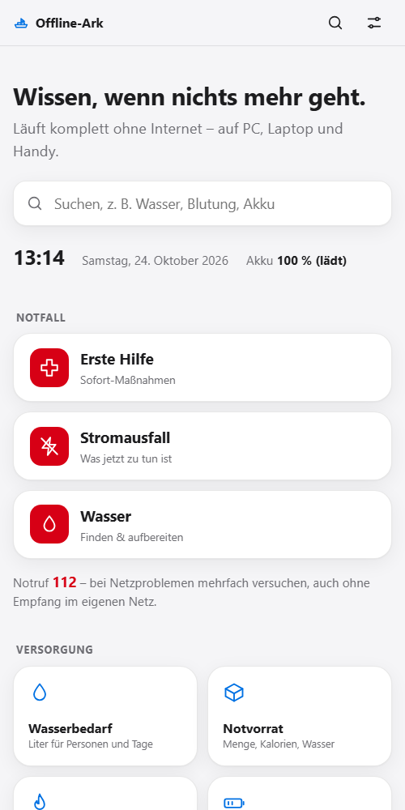
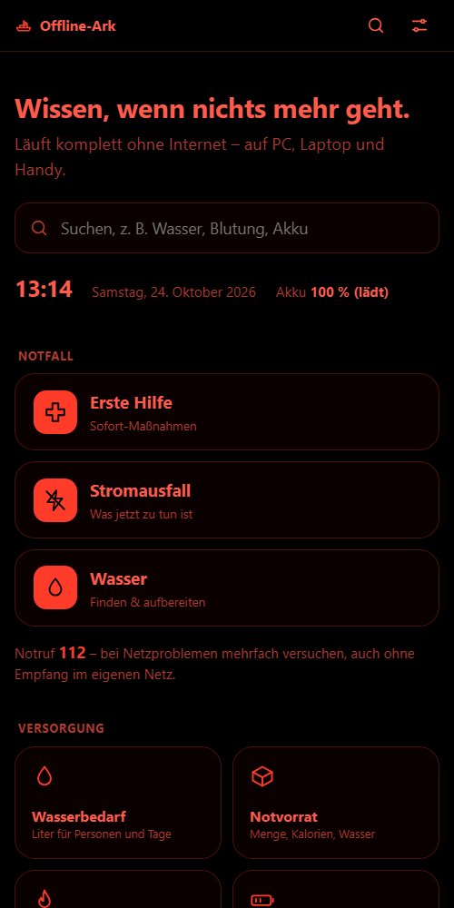
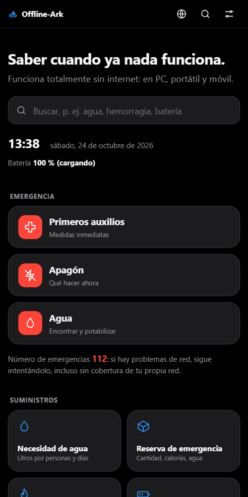
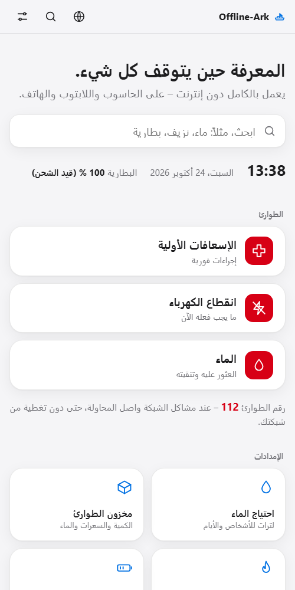

<div align="center">

# 🛟 Offline-Ark

**Emergency knowledge and tools. Completely offline.**

Power outage · network outage · disaster – just open `index.html`.

🇬🇧 English · [🇩🇪 Deutsch](README.de.md)


   

<sub>Light · Night (red on black, easy on eyes and battery) · Español · العربية (right to left)</sub>

</div>

---

## What is this?

**Offline-Ark** is an emergency website in **plain HTML, CSS and JavaScript**. It needs no server, no internet and no installation. Copy the folder to a USB stick, a hard drive or a phone and open `index.html` with a double click.

It is made for **ordinary people in Germany** who need quick answers under stress: large controls, simple language, no jargon.

### 🌍 Four languages: Deutsch · English · Español · العربية

Everything is available in all four languages: all tools, all knowledge pages, search, notes and the sources page. Arabic is displayed **right to left**.

- The language is taken from your browser on first start.
- Switch it with the globe icon at the top right. Language names are always shown in their own language.
- The content refers to **Germany** (emergency number 112, German authorities, German radio rules). The translations follow the German version; if they differ, the German text applies.
- The translations were created with AI assistance and have not yet been checked by native speakers, especially technical terms (first aid, plants, radio) in Arabic. Corrections are very welcome.

> The source texts of the knowledge pages live in `content/` (German) and `content/{en,es,ar}/`. The German README is [README.de.md](README.de.md).

## What is inside?

### 🆘 Emergency – one tap from the home page
**First aid** · **Power outage** · **Water**

### 🧰 37 tools

| Area | Tools |
|---|---|
| **In an emergency** | Emergency assistant (decision tree "What happened?") · Resuscitation rhythm (100–120/min, with sound) · Power outage plan (hour 1 to week 1) |
| **Supplies** | Water needs · Emergency supplies (based on BBK) · Purify water · Power & battery |
| **Calculate & time** | Units · Calculator · Stopwatch, timer, countdown |
| **Navigation** | Compass · Sun & daylight · Coordinates & GPS (UTM) · **Offline map** (whole world as a coarse base map with country and city names in four languages; detailed points for Baden-Württemberg: hospitals, pharmacies, defibrillators, fire stations, water points; your own points; more regions via `scripts/fetch-pois.js`) |
| **Signals & radio** | Morse code · SOS light · Radio cheat sheet (PMR446, Freenet, CB, Meshtastic) |
| **Communicate** | Printable notices · QR code generator (offline) · Chat on the local network (mini server) · Print pack |
| **Nature & identification** | Plants & mushrooms with dangerous look-alikes (photos) · Clouds & weather · Constellations · Animal tracks |
| **Self-sufficiency** | Garden calendar · Preserving food (canning, fermenting, drying) · Firewood calculator |
| **Learn & practise** | Quiz (also with photos) · Knots · Morse trainer |
| **Organisation** | Supply list with expiry warning · Notes & diary · Contacts & meeting points · Checklists (incl. documents) · Emergency passport · Kids' corner with games |

### 📖 10 knowledge pages
First aid · Power outage guide · Finding & purifying water · Hygiene & sanitation · Fire, warmth & shelter · Food · Navigation without GPS · Communication & radio · Power & energy off-grid · Repair basics

Plus an **offline search** across everything, a **library** of public-domain PDFs and a **Sources & Licenses** page.

## How to open it

1. Download the folder: green **Code → Download ZIP** button on GitHub, then unzip.
2. Double-click **`index.html`**. It opens in your browser.
3. Done. Nothing is loaded from the internet.

> 💡 Tip: bookmark it while you still have internet, and try it **once beforehand**, not only in an emergency.

## Copy it to a USB stick, hard drive or phone

| Device | How |
|---|---|
| **USB stick / hard drive** | Copy the whole `offline-ark` folder. On a PC open `index.html`. Do not change the folder structure. |
| **Android phone** | Copy the folder to storage via USB cable. Open `index.html` with a file app (Chrome or Firefox). Alternatively unzip the ZIP file. |
| **iPhone / iPad** | Access to local files is restricted. A laptop or an Android device is easier. Try it beforehand. |
| **Laptop** | Save the folder anywhere and double-click `index.html`. |

Notes:
- The **compass**, **GPS position** and **keeping the screen on** need the device's sensors. They work best on a phone. Some browsers only allow them over `https`; then the feature is unavailable and the page says so.
- Data is stored in the browser (`localStorage`). If you clear browser storage, it is gone. Back it up first (see below).

## Back up your own data (export)

Supply list, notes, contacts, waypoints, checklists and settings are stored **only on the device**, nowhere else.

- **Everything at once:** tap the settings icon at the top right → **Back up all data**. A file `offline-ark-daten-YYYY-MM-DD.json` is created.
- **Restore:** choose **Restore data** there and select the file.
- The supply list, notes, contacts and waypoints can also be exported directly on their own page.
- Keep the backup **outside** the device (USB stick, paper). Every page has a **print view**.

## Usage

- **Search:** at the top of the home page, finds tools and knowledge pages.
- **Settings** (icon at the top right): light, dark, **night**, text size, keep screen on, print, back up data.
- **Printing:** every page has a clean print view without controls.

## Print pack: the essentials on paper

Tool **Print pack** (home → Communicate): tick the parts – emergency card with spelling alphabet, emergency passport, contacts & meeting points, Morse table, knowledge pages, checklists to tick off, supplies table – and tap **Create print pack**. The pack has a table of contents, A4 pages with header and footer (date, emergency number 112), black on white, 10.5 pt, links written out, in the chosen language (also right to left) and, if you like, additionally in German. The page count is estimated in advance. **Preview only** opens no print dialog; in the print dialog you can choose "Save as PDF". The knowledge pages for this come from `data/print-pages.js` (generated by `node scripts/build.js`).

## Install as an app (optional)

Offline-Ark runs **without installation** with a double click (`file://`). If you also want it as an **app** on your home screen (own icon, no browser bar, starts without network), that works – but only from an address with **`https://`** or **`http://localhost`**:

- **Plain `file://` cannot do this.** Browsers only allow the required "service worker" on secure addresses. This is not a limitation of Offline-Ark.
- **GitHub Pages (https):** publish the repository (Settings → Pages), open the page once with internet, then choose **Install / Add to home screen** in the browser. After that everything also works without a network.
- **Local server:** in the project folder start e.g. `python -m http.server 8099` or `npx serve` and open `http://localhost:8099/`. On Windows, Python sometimes serves `.js` files with the wrong type (`text/plain`); then the service worker does not register – use `npx serve` instead.
- **On Wi-Fi (`http://192.168.…`) it does not work:** without HTTPS and without `localhost` the browser does not allow a service worker. The pages themselves still run there, they just cannot be installed as an app.
- On first open, all pages, scripts and data (about 5 MB) are stored; afterwards everything comes from storage. **Updates** apply from the **next start** of the app. The library **PDFs** are only stored on request (Library → **Save PDFs for offline use**) because they need a lot of space.
- Technical: `manifest.webmanifest`, `sw.js` (file list and version generated by `scripts/build-pwa.js`, runs with every `node scripts/build.js`), `js/pwa.js` (registers the service worker only on `http(s)`), icons in `icons/` (regenerate with `node scripts/make-icons.js`, needs Edge or Chrome).

## Everything in one file

For sharing via **messenger, Bluetooth, e-mail or USB stick** there is an export as **one single HTML file**, without folders and without a server:

```bash
node scripts/build.js          # generate pages (once beforehand)
node scripts/build-single.js   # -> dist/offline-ark.html
node scripts/build-single.js --no-pdf             # without PDFs (smaller)
node scripts/build-single.js --lang de,en         # only these languages (smaller)
```

The file contains all pages (home, tools, knowledge and library in all languages) with styles, scripts, dictionaries, data, images and PDFs (as Base64) and a small router. It is opened with a double click in the browser; language switching, links, search, printing and saved input (`localStorage`) work as in the folder. Size: about 8 MB without PDFs (all languages, maps, images), about 60 MB with all library PDFs. With `--no-pdf` it stays small, with `--lang de` it is smallest.

- Structure: every page is stored as text in the file and assembled with its scripts on opening, shown in an embedded frame (`iframe srcdoc`). The address looks like `offline-ark.html#/tools/zeit.html`; the browser's back button works.
- The file cannot be edited by hand. After changes in the project, simply generate it again.
- Limits: if a page or PDF is not included (e.g. `--no-pdf`), a notice page appears. The **chat on the local network** needs a server and therefore only works from the folder. On some phones (e.g. iPhone, file in messenger preview) an HTML file cannot be opened completely: open the file in the browser or use a laptop.

## For developers and contributors

```
offline-ark/
├── index.html          Home page
├── tools/*.html        the 37 tools
├── knowledge/*.html    knowledge pages, German (generated from content/*.md)
├── knowledge/{en,es,ar}/  the same pages in the other languages
├── css/style.css       entire design (light, dark, night, print, right-to-left)
├── js/                 shared code + one script per tool, i18n.js = languages
├── data/*.js           data as JS (instead of fetch, so file:// works)
├── data/i18n/*.js      translations of the tools and the interface
├── content/*.md        source texts of the knowledge pages (German) incl. sources
├── content/{en,es,ar}/ translations of the knowledge pages
├── library/            PDFs, images (library/images)
├── scripts/            generator and helper scripts (Node.js): build.js, build-pwa.js, build-single.js
├── server/             mini server with local chat (Node.js, no packages)
├── manifest.webmanifest, sw.js, icons/   app installation (optional, only over https/localhost)
├── dist/               (only after build-single.js) offline-ark.html = everything in one file
└── update-content.sh   reload content and regenerate pages
```

Rules: no framework, no CDN, no fonts or services from outside, no `fetch()` on local files, storage only via `localStorage` with `try/catch`.

### Translating
The **German text is the key**: `OA.t('Personen')` returns the translation; if it is missing, the German text stays. Static page texts are translated automatically. Dictionaries: `data/i18n/core.js` (interface, home page) and `data/i18n/tool-<name>.js` (per tool), format:

```js
OA.i18n.add({ "Personen": { en: "People", es: "Personas", ar: "الأشخاص" } });
```

Knowledge pages: translation as Markdown in `content/<language>/<page>.md`, then `node scripts/build.js`. A new language also needs an entry in `js/i18n.js` and `scripts/build.js`.

### Updating content
Texts live in `content/*.md`. Afterwards (with [Node.js](https://nodejs.org)):

```bash
./update-content.sh            # download PDFs, regenerate pages, check links
./update-content.sh --offline  # only regenerate pages
node scripts/build.js          # the same without Bash
```

The script downloads the public-domain PDFs listed in `scripts/library.json`, generates `knowledge/*.html`, the search index and the sources page, and checks the source links. If you only use the site, you do not need any of this.

### Tests
There is one test script per tool plus `scripts/test-i18n.js`. Run them all:

```bash
for f in scripts/test-*.js; do node "$f" || echo "FAILED: $f"; done
```

On Windows PowerShell: `Get-ChildItem scripts\test-*.js | ForEach-Object { node $_.FullName }`.

## ⚠️ Important notice

Offline-Ark **does not replace training**. Take a first-aid course. In an emergency call **112** first, or keep trying. The pages deliberately give **no medication doses**. For plants: only eat if you are 100 % certain of the identification. All information is carefully summarised from reputable sources, but provided without warranty.

## Sources and licenses

- **Own code and own texts:** [MIT License](LICENSE).
- **Third-party content** keeps its license. Every knowledge page lists its sources with link and license at the bottom, collected centrally on the *Sources & Licenses* page (`knowledge/en/quellen.html`; the file name is the same in all languages).
- Used, among others: recommendations from BBK, DRK, Federal Environment Agency, German Resuscitation Council, WHO, CDC, FEMA/ready.gov, Federal Network Agency and Wikipedia (CC BY-SA). Official texts are **not copied**, but summarised in our own words.
- Public-domain PDFs in the library (US government works, unchanged): *FM 4-25.11 First Aid*, *FM 21-10 Field Hygiene and Sanitation*, *ATP 3-50.21 Survival* and *FM 24-18 Tactical Single-Channel Radio Communications Techniques* (all US Army, marked "Approved for public release") as well as *Are You Ready?* and *Be Prepared for Any Hazard* (FEMA/ready.gov, passing on unchanged is allowed). Details are on the *Sources & Licenses* page.
- Maps and points of interest: © OpenStreetMap contributors (ODbL), outlines from Natural Earth (public domain). Photos: Wikimedia Commons (CC0, public domain, CC BY, CC BY-SA), credits under each photo and in `library/images/ATTRIBUTION.md`.

## Contributing

Found a mistake? A source out of date? Issues and pull requests are welcome. Please do not submit content without a clear, free license or sources without a link and license.

<div align="center"><sub>Built so that nobody has to search in an emergency.</sub></div>
