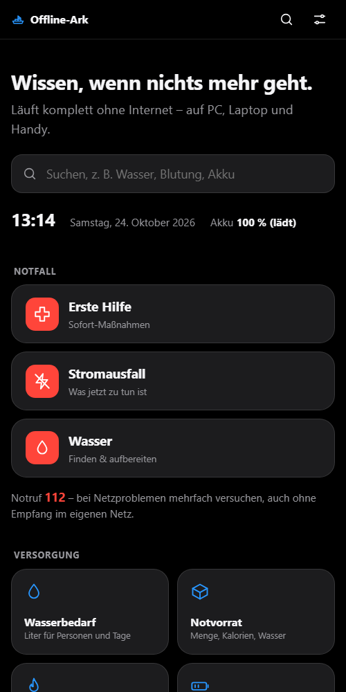

<div align="center">

# 🛟 Offline-Ark

**Wissen und Werkzeuge für den Ernstfall. Komplett ohne Internet.**

Stromausfall · Netzausfall · Katastrophe – einfach `index.html` öffnen.


  

<sub>Hell · Dunkel · Nacht (rot auf schwarz, schont Augen und Akku)</sub>

</div>

---

## Was ist das?

Offline-Ark ist eine Notfall-Website in **reinem HTML, CSS und JavaScript**. Sie braucht weder Server noch Internet noch Installation. Man kopiert den Ordner auf einen USB-Stick, eine Festplatte oder ein Handy und öffnet `index.html` per Doppelklick.

Gedacht für **ganz normale Menschen in Deutschland**, die unter Stress schnell Antworten brauchen. Große Bedienelemente, einfache Sprache, kein Fachchinesisch.

## Was steckt drin?

### 🆘 Notfall – ein Klick von der Startseite
**Erste Hilfe** · **Stromausfall** · **Wasser**

### 🧰 17 Werkzeuge

| Bereich | Werkzeuge |
|---|---|
| **Versorgung** | Wasserbedarf · Notvorrat (nach BBK) · Wasser entkeimen · Strom & Akku |
| **Rechnen & Zeit** | Einheiten · Taschenrechner · Stoppuhr, Timer, Countdown |
| **Orientierung** | Kompass · Sonne & Tageslicht · Koordinaten & GPS (UTM) |
| **Signal & Funk** | Morse-Code · SOS-Licht · Funk-Spickzettel (PMR446, Freenet, CB, Meshtastic) |
| **Organisation** | Vorratsliste mit Ablaufwarnung · Notizen & Tagebuch · Kontakte & Treffpunkte · Checklisten |

### 📖 9 Wissensseiten
Erste Hilfe · Stromausfall-Leitfaden · Wasser finden & aufbereiten · Feuer, Wärme & Unterschlupf · Nahrung · Hygiene & Sanitär · Navigation ohne GPS · Kommunikation & Funk · Strom & Energie off-grid

Dazu eine **Offline-Suche** über alles, eine **Bibliothek** mit gemeinfreien PDFs und eine Seite **Quellen & Lizenzen**.

## So öffnest du es

1. Ordner herunterladen: grüner Button **Code → Download ZIP** auf GitHub, danach entpacken.
2. Die Datei **`index.html`** doppelklicken. Sie öffnet sich im Browser.
3. Fertig. Es wird nichts nachgeladen.

> 💡 Tipp: Lege ein Lesezeichen an, solange du Internet hast. Und probiere es **einmal vorher** aus, nicht erst im Ernstfall.

## Auf USB-Stick, Festplatte oder Handy kopieren

| Gerät | So geht's |
|---|---|
| **USB-Stick / Festplatte** | Den ganzen Ordner `offline-ark` hineinkopieren. Auf dem PC `index.html` öffnen. Ordnerstruktur nicht ändern. |
| **Android-Handy** | Ordner per USB-Kabel in den Speicher kopieren. Mit einer Datei-App `index.html` öffnen (Chrome oder Firefox). Alternativ die ZIP-Datei entpacken. |
| **iPhone / iPad** | Hier ist der Zugriff auf lokale Dateien eingeschränkt. Einfacher ist ein Laptop oder ein Android-Gerät. Vorher ausprobieren. |
| **Laptop** | Ordner irgendwo speichern, `index.html` doppelklicken. Fertig. |

Hinweise:
- Der **Kompass**, die **GPS-Position** und das **Wachhalten des Bildschirms** brauchen die Sensoren des Geräts. Sie gehen am besten am Handy. Manche Browser erlauben sie nur über `https`. Dann ist die Funktion nicht verfügbar, und die Seite sagt das auch.
- Daten werden im Browser (`localStorage`) gespeichert. Wenn du den Browser-Speicher löschst, sind sie weg. Sichere sie vorher (siehe unten).

## Eigene Daten sichern (Export)

Vorratsliste, Notizen, Kontakte, Wegpunkte, Checklisten und Einstellungen liegen **nur auf dem Gerät**, nirgends sonst.

- **Alles auf einmal:** Oben rechts auf das Einstellungssymbol tippen → **Alle Daten sichern**. Es wird eine Datei `offline-ark-daten-JJJJ-MM-TT.json` erzeugt.
- **Wiederherstellen:** Dort **Daten wiederherstellen** wählen und die Datei auswählen.
- Die Vorratsliste, Notizen, Kontakte und Wegpunkte lassen sich außerdem direkt auf ihrer Seite exportieren.
- Bewahre die Sicherung **außerhalb** des Geräts auf (USB-Stick, Papier). Jede Seite hat eine **Druckansicht**.

## Bedienung

- **Suche:** auf der Startseite oben, findet Werkzeuge und Wissensseiten.
- **Einstellungen** (Symbol oben rechts): Hell, Dunkel, **Nacht**, Schriftgröße, Bildschirm anlassen, Drucken, Daten sichern.
- **Drucken:** jede Seite hat eine saubere Druckansicht ohne Bedienelemente.

## Für Entwickler und Ergänzer

```
offline-ark/
├── index.html          Startseite
├── tools/*.html        die 17 Werkzeuge
├── wissen/*.html       Wissensseiten (erzeugt aus content/*.md)
├── css/style.css       gesamtes Design (hell, dunkel, nacht, Druck)
├── js/                 gemeinsamer Code + ein Skript je Werkzeug
├── data/*.js           Daten als JS (statt fetch, damit file:// geht)
├── content/*.md        Quelltexte der Wissensseiten inkl. Quellenangaben
├── bibliothek/         PDFs, Bilder
├── scripts/            Generator und Hilfsskripte (Node.js)
└── update-content.sh   Inhalte neu laden und Seiten neu erzeugen
```

Regeln: kein Framework, kein CDN, keine Schriftarten oder Dienste von außen, kein `fetch()` auf lokale Dateien, Speicherung nur über `localStorage` mit `try/catch`.

### Inhalte aktualisieren
Texte stehen in `content/*.md`. Danach (mit [Node.js](https://nodejs.org)):

```bash
./update-content.sh            # PDFs laden, Seiten neu erzeugen, Links prüfen
./update-content.sh --offline  # nur Seiten neu erzeugen
node scripts/build.js          # dasselbe ohne Bash
```

Das Skript lädt die gemeinfreien PDFs aus `scripts/library.json`, erzeugt `wissen/*.html`, den Suchindex und die Quellenseite und prüft die Quellenlinks. Wer nur benutzt, braucht das alles nicht.

### Tests
```bash
node scripts/test-einheiten.js
node scripts/test-inventar.js
node scripts/test-notizen.js
node scripts/test-kontakte.js
node scripts/test-checklisten.js
```

## ⚠️ Wichtiger Hinweis

Offline-Ark **ersetzt keine Ausbildung**. Besuche einen Erste-Hilfe-Kurs. Im Notfall zuerst **112** wählen bzw. immer wieder versuchen. Die Seiten nennen bewusst **keine Medikamenten-Dosierungen**. Bei Pflanzen gilt: nur essen, wenn 100 % sicher bestimmt. Alle Angaben sind mit Sorgfalt aus seriösen Quellen zusammengefasst, aber ohne Gewähr.

## Quellen und Lizenzen

- **Eigener Code und eigene Texte:** [MIT-Lizenz](LICENSE).
- **Fremde Inhalte** behalten ihre Lizenz. Jede Wissensseite nennt unten ihre Quellen mit Link und Lizenz, zentral gesammelt auf der Seite *Quellen & Lizenzen* (`wissen/quellen.html`).
- Genutzt werden u. a. Empfehlungen von BBK, DRK, Umweltbundesamt, Deutschem Rat für Wiederbelebung, WHO, CDC, FEMA/ready.gov, Bundesnetzagentur und Wikipedia (CC BY-SA). Offizielle Texte sind **nicht kopiert**, sondern in eigenen Worten zusammengefasst.
- Gemeinfreies PDF in der Bibliothek: *FM 4-25.11 First Aid* (US-Armee).
- Die Startquellen [ligi/SurvivalManual](https://github.com/ligi/SurvivalManual) (GPL-3.0) und [PR0M3TH3AN/Survival-Data](https://github.com/PR0M3TH3AN/Survival-Data) (ohne Lizenzdatei) wurden als Themenanregung gelesen, aber **nicht kopiert**.

## Mithelfen

Fehler gefunden? Quelle veraltet? Issues und Pull Requests sind willkommen. Bitte keine Inhalte ohne klare, freie Lizenz einreichen und keine Quellen ohne Link und Lizenz.

<div align="center"><sub>Gebaut, damit man im Ernstfall nicht suchen muss.</sub></div>
